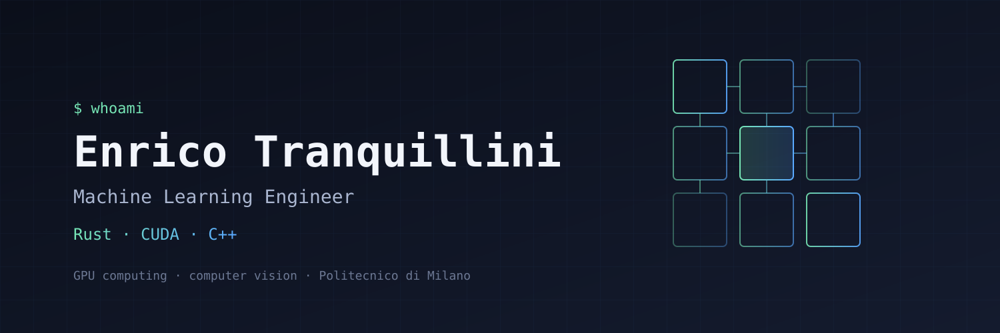

<!-- README WIP -->

  

# Hi, I'm Enrico 👋

Former student @ **Politecnico di Milano** — passionate about GPU computing, computer vision, and learning how things work at a low level.

Machine Learning Engineer working with Rust, CUDA, and C++.

AI is changing fast isn't it ;) ?

## Table of Contents

- [What I Work On](#what-i-work-on)
- [Tech Stack](#tech-stack)
- [Projects](#projects)
- [Contact](#contact)

## What I Work On

- GPU kernels and performance tuning (CUDA, tile-based programming)
- Computer vision and machine learning pipelines
- Systems-level code in Rust and modern C++

## Tech Stack

| Area | Tools |
|------|-------|
| Languages | Rust, C++, CUDA, Python |
| GPU / ML | CUDA, cuDNN, cuBLAS, PyTorch |
| Tooling | Git, CMake, Cargo, Linux |

## Projects

<!-- TODO: replace with real repos -->
- **Project name** — one-line description. [repo](https://github.com/iltranqui)

## Contact

<!-- TODO: add links -->
- GitHub: [@iltranqui](https://github.com/iltranqui)
- LinkedIn: _add link_
